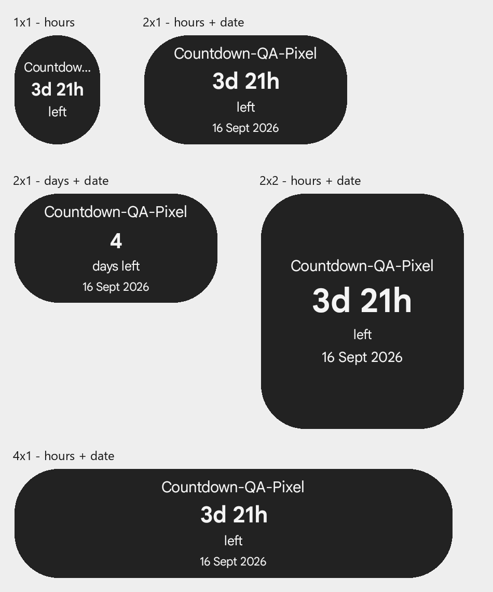

# Countdown

A small Android home-screen widget that counts down to an event in your calendar. Android 12 or newer. One widget type, with separate settings for each instance.

[Download the signed APK](https://github.com/TQNL/Countdown/releases/tag/v0.3.2) | [Privacy](PRIVACY.md) | [GNU GPL v3 or later](LICENSE)

## Why this exists

I liked the countdown widget in Samsung Calendar on my Galaxy A12 and wanted that same basic feature on my Pixel 9 Pro, where I use Smart Launcher and Google Calendar. Bringing the A12 back to life also gave me a spare phone for testing.

The idea was simple: pick a calendar event, put its countdown on the home screen, and keep the app itself small. I wanted function over form, plain labels, and a widget that remained useful at awkward sizes, including 1x1. Days and hours, an optional date, and support for the calendars already synced to the phone grew out of using and testing it.

## What it does

- Select events from Android's shared calendar database; search by title or filter by calendar.
- Show calendar days, or enable **Show hours** for days and whole hours.
- Optionally show the date when space allows.
- Resize from 1x1 to larger shapes; follow the phone's light or dark theme.
- Name widget instances and configure each one separately.
- Tap the widget to open its event in a calendar app.
- In widget settings, tap the event card or **Open in calendar** to open that exact event in your calendar app. In Google Calendar, tap the pencil on the event page to edit it. **Change event** selects a different event for the widget.
- Use **Open calendar** in the picker to browse or edit events, then return to select one in Countdown.

No account, ads, analytics, or app-operated cloud service. Calendar sync is handled by your existing calendar app. Apps that keep events in a private database are not supported.



## Install and use

1. Download `countdown-0.3.2.apk` from [Releases](https://github.com/TQNL/Countdown/releases). Android may ask you to allow installation from the browser or file manager you use.
2. Open Countdown and allow calendar access.
3. Add **Countdown** using your launcher's widget picker or the app's **Add widget** button.
4. Tap **Select event**, choose an event, review display options, and press **Save**.
5. To change it later, use your launcher's **Configure/Settings** action or select the widget in the app. **Cancel** discards unsaved changes.

In Smart Launcher, keep your finger down from the initial long press while dragging between pages, wait at the edge for the page to switch, then drop in free space. Cell dimensions and minimum sizes depend on the launcher. A small widget may shorten the title or omit the date.

## Counting and refresh

Days-only mode compares calendar dates. A timed event that started earlier today shows `<1 day ago`; past dates show `1 day ago`, `2 days ago`, and so on. At the exact start time, timed events show **Now**. Hours mode counts whole elapsed hours, split into 24-hour days; less than an hour is shown as `<1h`. All-day events use their calendar date and show **Today** throughout that local day. Daylight-saving transitions can therefore make the two modes differ.

A recurring event selection refers to one occurrence; it does not automatically roll forward. A changed or deleted occurrence may require reselection. Google Calendar does not expose a compatible event-returning picker on the tested Pixel, so the calendar shortcut does not select an event for you.

Calendar observers, WorkManager, and system clock/date broadcasts request updates. Both modes also refresh on minute ticks while the app process is alive and the screen is interactive. Android may delay background work, so exact update timing after long idle periods is not guaranteed. No exact-alarm or battery-exemption permission is requested.

## Build

Use JDK 17 or 21 and Android SDK platform 36. Set `ANDROID_HOME`, or create an ignored `local.properties` containing your `sdk.dir`. Then run:

```sh
./gradlew :app:assembleDebug :app:testDebugUnitTest :app:lintDebug
```

On Windows, use `gradlew.bat`. The app uses Kotlin, Compose for screens, Jetpack Glance for widgets, and WorkManager. Dependencies and the Gradle distribution checksum are pinned in the repository.

For your own signed release, set `COUNTDOWN_KEYSTORE` to your keystore's absolute path, `COUNTDOWN_STORE_PASSWORD`, and optionally `COUNTDOWN_KEY_ALIAS` (defaults to `countdown`) and `COUNTDOWN_KEY_PASSWORD` (defaults to the store password). Run `./gradlew :app:assembleRelease`. Without signing variables, the release output is unsigned. Never commit signing keys or passwords.

## Status and testing

0.3.2 is an early public release. The signed release was checked on Pixel 9 Pro with Smart Launcher, including opening the selected calendar event from both settings actions. Countdown modes were checked in 0.3.1. Earlier testing covered a Samsung Galaxy A12 (Android 12 / One UI Core 4.1) and Pixel 9 Pro (Android 17 / Smart Launcher 6.6). Build, lint, and 23 unit tests passed before publishing. Long-idle battery behavior and every launcher/font configuration have not been exhaustively tested. Please report reproducible issues with your Android and launcher versions, without private calendar information.

## AI disclosure

This project was developed with substantial help from OpenAI Codex, including code, debugging, and documentation. I chose the features and tested the behavior on my phones with AI-assisted tooling. It is AI-assisted software and remains my responsibility to maintain; the app itself contains no AI service or model.

## License

Countdown is licensed under the **GNU General Public License, version 3 or (at your option) any later version**. See [LICENSE](LICENSE). Dependencies retain their own licenses; see [THIRD_PARTY_NOTICES.md](THIRD_PARTY_NOTICES.md).
